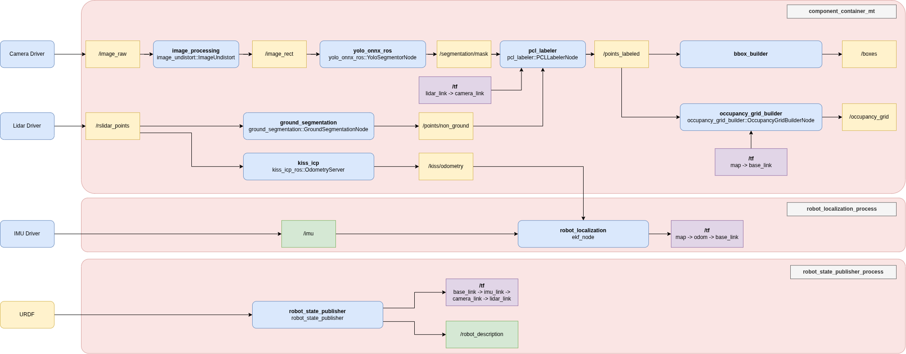

# ROS 2 Occupancy Grid Builder Workspace

This workspace contains ROS 2 packages for LiDAR perception, ground segmentation, object labeling, localization, and occupancy-grid generation, together with the launch and configuration files that bring the system up.

## Requirements

- Ubuntu 24.04
- ROS 2 Jazzy
- `colcon` build tools

## Get Submodules

The workspace includes Git submodules for ground segmentation, ONNX ROS, and KISS-ICP. After cloning the workspace, initialize and fetch them recursively:

```bash
cd /home/dev/ws
git submodule update --init --recursive
```

This can also be done with `make clone-gitmodules` from the workspace root.

Install the ROS and system dependencies required by the packages, then resolve package dependencies from the workspace:

```bash
cd /home/dev/ws
rosdep update
rosdep install --from-paths src --ignore-src -r -y
```

## Packages

| Package | Description |
| --- | --- |
| `bbox_builder` | Builds bounding-box data from perception results. |
| `ground_segmentation` | ROS 2 component and segmentation plugins for classifying ground points. |
| `image_processing` | Image processing components, including image undistortion. |
| `kiss_icp` | LiDAR odometry component. |
| `occupancy_grid_builder` | Builds occupancy-grid output from perception data. |
| `occupancy_grid_builder_bringup` | System launch files, configuration, and RViz setup. |
| `pcl_labeler` | Labels and clusters point-cloud data. |
| `robot_description` | Robot description and frame configuration. |
| `yolo_onnx_ros` | ROS 2 component for ONNX-based image segmentation. |

## Build

From the workspace root, build the C++ libraries and ROS 2 packages using the workspace Makefile:

```bash
cd /home/dev/ws
make build-all
source install/setup.bash
```

Alternatively, build the ROS 2 packages with `colcon` when their external C++ dependencies have already been built:

```bash
cd /home/dev/ws
source /opt/ros/jazzy/setup.bash
colcon build --symlink-install
source install/setup.bash
```

## Architecture

The diagram below shows the main data flow and ROS components in the workspace.



## Run

Launch the complete system:

```bash
ros2 launch occupancy_grid_builder_bringup occupancy_grid_builder_bringup.launch.py
```

The launch file accepts these arguments:

- `topic` (default: `/rslidar_points`): input point-cloud topic.
- `visualize` (default: `true`): start RViz.
- `use_sim_time` (default: `true`): use the simulation clock.
- `base_frame` (default: `base_link`): robot base frame.
- `lidar_odom_frame` (default: `odom`): LiDAR odometry frame.

For example, to use another input topic and disable RViz:

```bash
ros2 launch occupancy_grid_builder_bringup occupancy_grid_builder_bringup.launch.py \
  topic:=/custom_points \
  visualize:=false \
  use_sim_time:=false
```

When playing a ROS bag, publish its clock so nodes using simulation time stay synchronized:

```bash
ros2 bag play <bag_directory> --clock
```

## Clean Build Artifacts

```bash
cd /home/dev/ws
make clean-all
```

## TODO

Improve 3D segmentation and point-cloud processing:
- [x] Remove ground from PCL to improve 3D segmentation. 
- [x] Erode Mask to avoid edge artifacts.
- [ ] Add a cluster-size limit for PCL clusters.
- [ ] Remove cluster outliers.

Reduce end-to-end latency in the perception pipeline.
- [x] Measure the latency of the full pipeline (Average: 427 ms). From ROS message timestamp to occupancy grid publication.
- [ ] Measure the latency of individual components in the pipeline.
